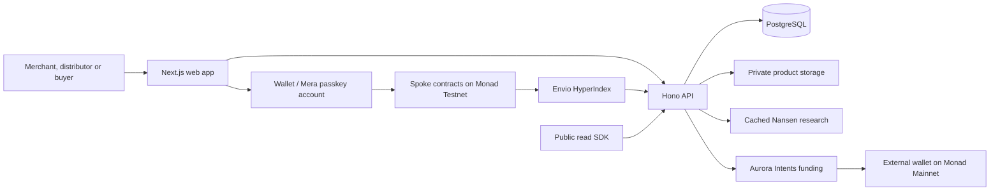

<p align="center">
  
</p>

# Spoke

**Turn product recommendations into a distribution network with rewards for settled sales.**

[Website](https://usespoke.xyz) · [Documentation](https://docs.usespoke.xyz) · [Try the demo](https://usespoke.xyz/demo) · [X / @usespoke_](https://x.com/usespoke_) · [npm SDK](https://www.npmjs.com/package/@enochid/spoke-sdk)

[](https://github.com/Enoch208/spoke/actions/workflows/ci.yml)
[](LICENSE)

Spoke is an open distribution protocol on Monad. Merchants publish products and fund campaign rewards. Distributors create referral links that can branch through other people. When a purchase settles, the eligible people on its referral path can claim the shares defined by the merchant’s public policy.

The app brings campaign discovery, partner research, invitations, referral graphs, checkout, delivery and earnings into one place. Public receipts make attribution inspectable, and a distributor’s settled record can be shared across merchants.

**Current deployment:** commerce runs on **Monad Testnet** using non-redeemable SDUSD. **Demo mode** is a separate, labelled walkthrough with sample data. Aurora wallet funding receives real USDC on **Monad Mainnet** and stays separate from testnet commerce.

## Start here

| I want to…                            | Start with                                                                   |
| ------------------------------------- | ---------------------------------------------------------------------------- |
| Understand the product                | [First five minutes](https://docs.usespoke.xyz/quickstart)                   |
| Try the interface without transacting | [Demo walkthrough](https://usespoke.xyz/demo)                                |
| Sell a product                        | [Merchant guide](https://docs.usespoke.xyz/guides/merchants)                 |
| Share campaigns and earn              | [Distributor guide](https://docs.usespoke.xyz/guides/distributors)           |
| Inspect a settled purchase            | [Example receipt](https://usespoke.xyz/receipts/10143/4)                     |
| Build on Spoke                        | [Developer documentation](https://docs.usespoke.xyz/developers/architecture) |

## How it works

1. **Launch:** a merchant creates a product, sets commission terms and deposits a reward budget.
2. **Distribute:** people join the campaign and create links. A link can branch from another link, preserving its ancestry.
3. **Purchase:** the buyer approves checkout. The contract records the accepted policy and reserves any eligible reward from the merchant’s budget.
4. **Settle:** the merchant may refund before the hold expires. After the hold, anyone can finalize an eligible sale.
5. **Claim:** distributors claim their allocated rewards, and the merchant claims sale proceeds. Only settled sales contribute to public performance records.

## The rules

| Rule                                       | What it means                                                                                                                                                                                  |
| ------------------------------------------ | ---------------------------------------------------------------------------------------------------------------------------------------------------------------------------------------------- |
| A real sale is the only trigger            | No reward for clicks, sign-ups or recruiting.                                                                                                                                                  |
| Rewards are pre-funded                     | A referred purchase the pool cannot cover is refused before payment. A direct purchase reserves no commission.                                                                                 |
| The split is a public policy               | The merchant sets the rate, the cap and the weight of each level, nearest first (for example 50 / 25 / 15 / 10). The remainder of any rounding goes to the nearest person, so no unit is lost. |
| The graph can be deep, payouts are bounded | Links form a branching graph; each sale pays a finite, disclosed number of levels. Prototype capacity limits apply.                                                                            |
| Terms never change after a sale            | Every accepted sale keeps the policy it was made under.                                                                                                                                        |
| Refund or finalize, never both             | A pending sale is refunded by the merchant before its unlock time, or finalized by anyone after it.                                                                                            |
| Only settled sales count                   | Pending and refunded sales never reach a public profile.                                                                                                                                       |

## What is built

The core web app and API are deployed, with settlement on Monad Testnet:

- Merchant setup, versioned products, campaign publication and management, referral links and graphs, checkout, buyer delivery, receipts, refunds and claims in the web app.
- Merchant campaign invitations with opted-in recipients, current reward terms, an acceptance inbox and confirmed link participation. Accepting an invitation does not create a link; the distributor approves that transaction separately.
- An immutable settlement contract with separate reward and buyer-payment ledgers, 1–5 commission levels, refunds, finalization, pull claims and future policy versions with 24 hours' notice.
- A 6-decimal testnet demo token (`SpokeDemoUSD`, not a stablecoin and not redeemable), generated contract ABIs, shared reward math and schemas for all 190 client methods.
- A PostgreSQL API implementing 136 core client methods for wallet sessions, immutable product versions, campaign publication, graph exploration, receipts, six earnings buckets, merchant vaults, reports and privacy-aware distributor records. Four optional methods support separate mainnet wallet funding; another 50 designed methods return an explicit unavailable error.
- Envio HyperIndex settlement and SDUSD event indexing, canonical replay and reorganization checks. HyperSync supplies history; native RPC supplies live events with TLS verification and bounded log ranges.
- Cached Nansen context for four demonstration distributors, labelled as supported mainnet history. These new wallets have no observed history; page views do not purchase provider queries, and insights never determine payouts.
- Passkey accounts and signing sessions with Mera, plus private campaign notes protected by a separate PRF namespace. Notes are encrypted locally and never sent to the API or blockchain.
- Email sign-in through Reown's one-time codes and embedded EOA wallets, using the same signed backend session as external wallets. No browser wallet extension is required.
- Private product uploads and buyer-only delivery that checks sale state directly onchain, plus a bounded testnet gas station with durable transaction retries.
- A typed public read SDK, request and response validation, contract invariants and an actual frontend-client-to-API-to-contract settlement journey.
- A scripted two-merchant testnet settlement proof with four rewarded levels, a branch, a separate refund, successful claims and protected unused-budget withdrawals.

The contracts are source verified through Monad Sourcify, with exact matches for creation and runtime bytecode. Live pages use the deployed API and indexed contract state; Demo uses local fixtures. Prototype contract limits are 128 campaigns, 256 nodes and 100 sales per campaign. External commerce integrations, teams, webhooks and multi-currency settlement remain designed previews, with no live financial behavior.

Optional mainnet wallet funding is configured in the hosted app. It accepts supported EVM source assets and quotes native USDC on Monad Mainnet to an authenticated external wallet. Deployments without an app key display an unavailable state. This separate route never credits testnet checkout, campaign budgets or earnings. Spoke shows provider progress and independently verifies the destination USDC receipt before marking funding as received. Mainnet commerce settlement is not implemented.

## Sign in with email

Open [Sign in](https://usespoke.xyz/login) or choose **Continue with email** when checkout asks you to sign in. Enter your email, complete Reown's one-time-code verification, then confirm the sign-in message. Spoke verifies the wallet signature and creates its normal secure session before returning you to your original page. Reown handles the email, verification codes and embedded wallet; Spoke does not store the codes.

Use the same sign-in method to return to an existing account. An email wallet has its own address and does not automatically inherit a passkey or external wallet's campaigns, purchases or earnings. Mera private notes still require the original passkey. Email accounts use the existing wallet transaction flow; testnet transactions still need testnet gas.

For self-hosting, set `NEXT_PUBLIC_REOWN_PROJECT_ID` before building the web app, enable email login in that Reown project and configure the project's allowed production origins. Without a project ID, email sign-in is hidden. Email and wallet availability also depends on the provider's configuration and service status.

## Research distribution partners

Sign in as a merchant and open [Distributors](https://usespoke.xyz/distributors). Search a shared name, handle or public wallet, narrow by category and settled activity, then select two or three people and choose **Compare selected**. The comparison shows settled, direct and network sales, merchant diversity, campaigns and the latest settlement. Open the supporting receipts or each full profile to inspect their contribution before deciding who to work with. Selections survive filters and page reloads.

Only shared fields appear; hidden values are never treated as zero. Pending and refunded sales do not count as settled performance. A sale can credit several people, so candidate columns must not be added together. Monetary totals appear only when complete receipt evidence establishes one token denomination.

**Review wallet context** opens separate, cached research for a public wallet. Its networks, source and age are disclosed. It never affects directory ranking or rewards, and a page view does not buy a provider refresh. Private and pseudonymous profiles cannot be used to retrieve external wallet context. Demo mode labels all sample records.

## Invite distributors to a campaign

Open **Sell → Partners → Invite distributor**, enter a registered wallet, choose an active campaign and send an optional message. Recipients must enable invitations in their reputation settings. Spoke records the current contract terms and policy hash with the invitation; it blocks duplicate open invitations, self-invitations and distributors who already have a campaign link.

The distributor opens **Earn → Invitations**, reviews the original and current terms, then accepts or declines. They can accept now and create their link later. Joining requires a separate transaction approved by the invited wallet. **Sent invitations** shows **Joined** only after the link is confirmed and indexed. Pending invitations can be withdrawn; expired or withdrawn invitations cannot be accepted. Invitations do not restrict the deployed campaign contract's open participation model or create rewards by themselves.

## Private campaign notes

Sign in with a passkey, open a campaign and choose **Open private notes**. Write an outreach plan, then **Encrypt & save** and confirm the same passkey. Saving locks the notebook; reopening it requires that passkey again. Each campaign has separate notes.

Mera evaluates `SHA-256("spoke.campaign-notes.v1")` as a dedicated WebAuthn PRF salt. HKDF-SHA-256 derives a non-extractable AES-256-GCM key, bound to the account, chain, campaign and credential. Every save generates a new nonce. This namespace does non-account work; it does not change the existing wallet derivation or signing session.

Only ciphertext and the metadata needed to reopen it persist in this browser. Unlocked text stays in page memory until locked, navigation, sign-out or the five-minute limit. This is local storage, not cloud sync: keep both the browser data and the same passkey. Clearing browser data loses the notes, and a wallet recovery phrase cannot restore this separate namespace.

## Architecture



**Contracts own settlement.** They enforce reward coverage, accepted terms, refunds and claims. The API validates requests, manages sessions and application records, and prepares transactions for the user’s wallet. Indexing turns onchain events into queryable app views; it cannot create a payout. Mainnet funding and wallet research are separate integrations, outside the testnet settlement ledger.

| Directory                                  | Responsibility                                                        |
| ------------------------------------------ | --------------------------------------------------------------------- |
| [`apps/web`](apps/web)                     | Next.js interface, account flows, transaction journeys and dashboards |
| [`apps/api`](apps/api)                     | Hono API, authentication, product delivery and derived reads          |
| [`packages/contracts`](packages/contracts) | Solidity settlement contracts, deployment scripts and Foundry tests   |
| [`packages/protocol`](packages/protocol)   | Shared Zod schemas, generated ABIs, chain definitions and reward math |
| [`packages/sdk`](packages/sdk)             | Published TypeScript client for public reads                          |
| [`indexer`](indexer)                       | Envio HyperIndex configuration and event handlers                     |
| [`ops`](ops)                               | Database and private-asset backup tooling                             |

Read the [architecture](https://docs.usespoke.xyz/developers/architecture), [data model](https://docs.usespoke.xyz/developers/data-model) and [authentication boundaries](https://docs.usespoke.xyz/developers/authentication) for more detail.

## Public API and SDK

The published SDK supports 32 credential-free public methods with validated inputs and responses. It reads campaigns, graphs, receipts and profiles; it does not sign transactions or hold private keys.

```sh
npm install @enochid/spoke-sdk@0.1.2
```

```ts
import { createSpokeClient } from "@enochid/spoke-sdk";

const spoke = createSpokeClient({ baseUrl: "https://api.usespoke.xyz" });
const receipt = await spoke.read("receipts.get", { saleId: "4", chainId: 10143 });
```

Use the API origin without `/v1`. Monetary values are base-unit strings. See the [SDK guide](https://docs.usespoke.xyz/developers/sdk), [API reference](https://docs.usespoke.xyz/developers/api), [endpoint registry](https://api.usespoke.xyz/v1/system/endpoints) and [SDK changelog](packages/sdk/CHANGELOG.md).

## Local development

Requires Node.js 24+, pnpm 10.33.0, Foundry 1.5.1 and PostgreSQL 16. Docker is optional for running PostgreSQL. Install the pinned dependencies from the lockfile.

```sh
git clone https://github.com/Enoch208/spoke.git
cd spoke
pnpm install --frozen-lockfile
cp apps/api/.env.example apps/api/.env
cp apps/web/.env.example apps/web/.env.local
```

For a disposable local database:

```sh
docker run --name spoke-postgres -d \
  -e POSTGRES_USER=spoke -e POSTGRES_PASSWORD=spoke -e POSTGRES_DB=spoke \
  -p 127.0.0.1:54332:5432 postgres:16.10-bookworm
```

```sh
pnpm chain
```

Keep Anvil running. In another terminal, follow the [local contract deployment steps](packages/contracts/README.md#run-the-settlement-fixture), using an Anvil-funded development account. Set the returned protocol and token addresses in both environment files, then start the apps:

```sh
pnpm dev
```

Open [localhost:3040](http://localhost:3040); the API listens on [localhost:8740](http://localhost:8740). The API applies its database migrations on startup. Optional provider integrations require their own configuration; credentials belong in local environment files, never browser variables or commits.

See [local development](https://docs.usespoke.xyz/developers/local-development), [configuration](https://docs.usespoke.xyz/developers/configuration), the [API guide](apps/api/README.md), [indexer setup](indexer/README.md) and [operations guide](ops/README.md).

## Validation

```sh
pnpm typecheck
pnpm lint
pnpm format:check
pnpm contracts:test
pnpm test
pnpm build
pnpm --filter @enochid/spoke-sdk release:check
```

`pnpm abi` regenerates the shared contract ABIs. Database and chain integration tests require the dedicated test services and environment variables defined in [CI](.github/workflows/ci.yml); a test run without those services does not cover the full journey.

The latest application release passed **678 application tests and 33 contract tests**, plus formatting, lint, typechecks, ABI parity, indexer generation, production builds and isolated SDK installation. See the [verified CI run](https://github.com/Enoch208/spoke/actions/runs/38479115431). Browser checks covered desktop and narrow mobile layouts. Controlled testnet wallets exercised purchase, refund, finalization, claims and invitation-to-join journeys; these are demonstration transactions, not customer revenue.

## Network

Monad Testnet, chain ID 10143, explorer [MonadVision](https://testnet.monadvision.com). Commerce settlement uses testnet demo tokens with no monetary value. Optional wallet funding runs separately on Monad Mainnet and involves real funds; it does not fund these testnet contracts.

| Contract      | Address                                                                                           | Deployment transaction                                                                                               |
| ------------- | ------------------------------------------------------------------------------------------------- | -------------------------------------------------------------------------------------------------------------------- |
| SpokeProtocol | [0x1Fa5…3eca](https://testnet.monadvision.com/address/0x1Fa5e94e44DB2101664C0a24dBf1e52912af3eca) | [0xabc0…abaf](https://testnet.monadvision.com/tx/0xabc0a2e3328332bd9b5a869fe8388718ded540a7623fea8fdb0ce9888da8abaf) |
| SpokeDemoUSD  | [0xb627…8E23](https://testnet.monadvision.com/address/0xb6279237003eD710bB4ccE6fbd126e07eD4D8E23) | [0xa7c7…c231](https://testnet.monadvision.com/tx/0xa7c7c5190fd2907510394a0baf44302d463c400f4f9b3ded703ee923918bc231) |

Deployment blocks, compiler settings, checked token metadata and source-verification evidence are in [the deployment manifest](packages/contracts/deployments/10143.json).

The [settlement proof](packages/contracts/deployments/10143-proof.json) records real testnet transactions, allocations, refund and finalization times, claimed balances and ledger reconciliation. These are scripted demonstration wallets using non-redeemable SDUSD, not customer revenue. [Reproduction commands](packages/contracts/README.md) cover Anvil and the checked testnet deployment.

The [hosted API journey](packages/contracts/deployments/10143-production-journey.json) records 15 confirmed onchain transactions in a journey using the actual frontend client and HTTPS API: campaign publication and funding, two referral nodes, purchases, buyer delivery, refund access revocation, finalization and all claims. [Campaign 3](https://usespoke.xyz/c/3) remains active; [sale 4](https://usespoke.xyz/receipts/10143/4) finalized and [sale 5](https://usespoke.xyz/receipts/10143/5) refunded. Global reconciliation matched every campaign, and the contract's 4.9 SDUSD balance exactly covered its remaining liabilities. A fresh backup restored 90 indexed events, four insight caches and the unchanged credit reservation into a disposable database; the asset archive was readable. Backups are host-local.

## Roadmap

Completed capabilities are described above. The next milestones are priorities, not release-date commitments.

| Milestone                         | Status / remaining work                                                                                                                        |
| --------------------------------- | ---------------------------------------------------------------------------------------------------------------------------------------------- |
| Testnet commerce and distribution | Deployed: campaigns, branching links, checkout, delivery, refunds and claims                                                                   |
| Partner discovery and invitations | Deployed: compare shared records, send invitations, accept and confirm campaign participation                                                  |
| Developer distribution            | Published SDK and [documentation](https://docs.usespoke.xyz); expand examples and integration coverage                                         |
| Aurora mainnet journey            | Funding integration deployed; complete transfer evidence and a genuine in-app use of received mainnet funds                                    |
| Operational readiness             | Extend load and recovery testing, move beyond prototype capacity limits, strengthen backup resilience and complete independent security review |
| Broader commerce                  | External checkout integrations, webhooks, teams and additional settlement assets remain planned                                                |

## Contributing

Open an [issue](https://github.com/Enoch208/spoke/issues) with the behavior, reproduction steps and affected network before a substantial change. Keep pull requests focused, add tests for changed behavior and run the relevant checks. Never include credentials, private wallet material or customer data in an issue or commit.

Product updates and discussion: [@usespoke_ on X](https://x.com/usespoke_). Guides and technical reference: [docs.usespoke.xyz](https://docs.usespoke.xyz).

## License

Spoke is released under the [MIT License](LICENSE). Third-party assets retain their respective licenses.

## Credits

The landing page shows third-party marks for two reasons only: the "Built on" strip and the inner ring of the developer section credit the open-source tools and network Spoke is built with, and the outer ring shows everyday apps a Spoke link can be shared in, since a link is a plain URL. None of them implies a partnership or an integration. Each mark belongs to its owner. The Solidity logo is by the Solidity team and licensed under [CC BY 4.0](https://creativecommons.org/licenses/by/4.0/). Most marks come from [Simple Icons](https://simpleicons.org); the Monad, Foundry and viem marks come from their official sites and repositories.
